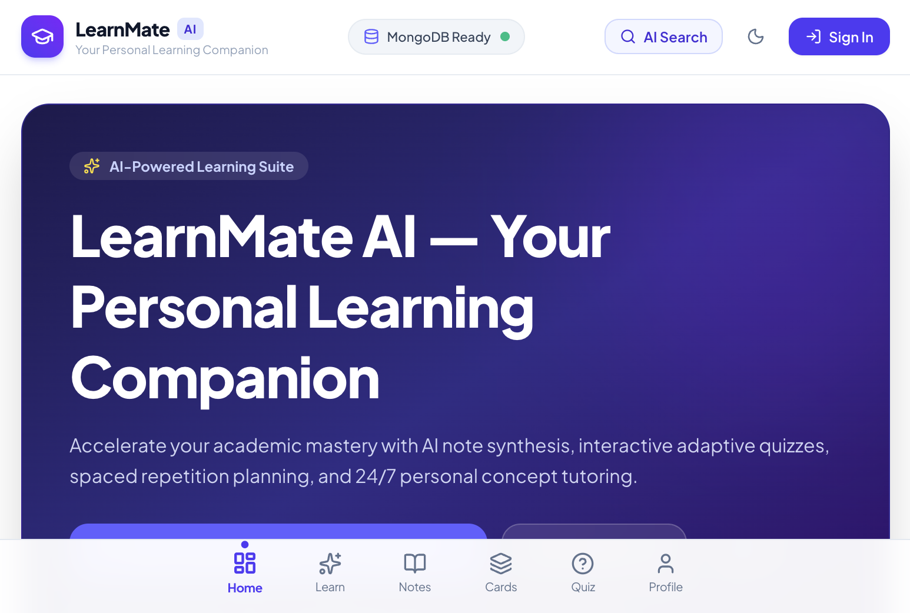
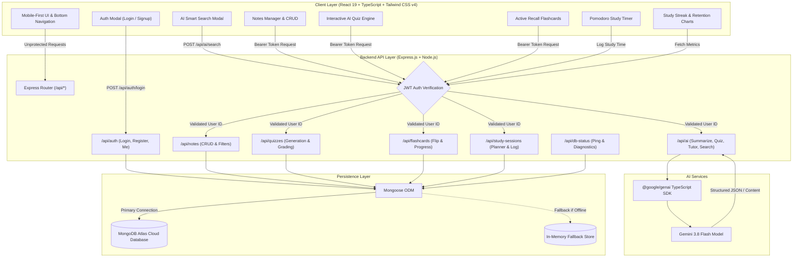

<div align="center">

# 🎓 LearnMate AI — Your Personal Learning Companion
### *Accelerate Academic Mastery with AI Note Synthesis, Adaptive Quizzes & Spaced Repetition*

<p align="center">
  <a href="https://learnmate-ai-8908.ai.studio">
    
  </a>
  <a href="#-technology-stack">
    
  </a>
  <a href="#-technology-stack">
    
  </a>
  <a href="#-technology-stack">
    
  </a>
  <a href="#-technology-stack">
    
  </a>
  <a href="#-technology-stack">
    
  </a>
  <a href="#-technology-stack">
    
  </a>
  <a href="#-technology-stack">
    
  </a>
  <a href="#-license">
    
  </a>
</p>

### 🔗 **Live Link:** [live demo](https://learnmate-ai-8908.ai.studio)
Experience the full-stack applet live in production: **[live demo](https://learnmate-ai-8908.ai.studio)**

</div>

---

## 📱 Application Screens & Preview

<p align="center">
  
</p>

*Figure 1: LearnMate AI mobile-first and desktop responsive learning hub with AI search modal, live MongoDB connection indicator, and unified study navigation.*

---

## 🌟 Key Features

### 1. 🧠 AI Learning Workspace (Powered by Google Gemini 3.8 Flash)
- **AI Notes Summarizer**: Pasted lecture notes or articles are processed into executive summaries, core conceptual takeaways, terminology glossaries, and high-yield revision bullet points. 1-click sync saves results directly into user notes.
- **AI Quiz Generator**: Generates adaptive multiple-choice quizzes with Easy, Medium, and Hard difficulty presets. Includes instant pedagogical explanations for all choices and persistent score tracking.
- **Ask AI Tutor**: An empathetic 24/7 conversational tutor that breaks down complex ideas into intuitive analogies, real-world examples, and step-by-step reasoning.
- **Smart Revision Planner**: Computes personalized spaced-repetition study milestones leading up to target exam dates with 1-click database synchronization.
- **Instant AI Smart Search**: Global search modal powered by Gemini AI that returns concise definitions, key principles, and related topics in real time.

### 2. 🗂️ Active Recall Flashcards & Pomodoro Focus
- **Flashcards Suite**: Flip-card interactive review with visual progress counters, mastered vs. review classification, and instant card creation.
- **Integrated Pomodoro Timer**: 25-minute focus intervals and 5-minute restorative breaks with gentle audio chimes and study streak updates.

### 3. 📊 Learning Analytics & Streak Tracking
- **Quantified Retention Metrics**: Real-time study streak calculation, daily target completion percentage, and weekly 7-day study breakdown.
- **Subject-wise Performance**: Analyzes notes cataloged, quizzes mastered, and minutes logged across academic subjects.

### 4. 🔒 Enterprise Security & Dual-Mode Persistence
- **MongoDB Atlas Integration**: Production-ready Mongoose schemas with indexes for high throughput.
- **Zero-Config In-Memory Fallback**: Resilient fallback memory store ensuring seamless evaluation even if external database credentials are not yet configured.
- **Live Connection Diagnostics**: Instant latency ping and database health indicators visible in the UI.
- **JWT & Salted Bcrypt Authentication**: Strict user isolation protecting private study data.

### 5. 📱 Mobile-First PWA Experience
- Clean, crisp white & indigo design system eliminating horizontal overflow across 360px, 390px, 430px viewports.
- Mobile bottom navigation bar (Home, Learn, Notes, Flashcards, Quiz, Profile).
- Offline banner and PWA installable manifest for iOS, Android, and Desktop.

---

## 🏗️ Architecture & Project Flow

The following diagram illustrates how user interactions flow through the React client, Express API gateway, authentication middleware, Gemini AI SDK, and MongoDB Atlas database:



---

## 🛠️ Technology Stack

| Layer | Technology | Official Logo / Badge | Purpose |
| :--- | :--- | :--- | :--- |
| **Frontend Framework** | React 19 |  | Dynamic, component-driven UI with Hooks and Context |
| **Language** | TypeScript |  | End-to-end static typing and interfaces |
| **Styling** | Tailwind CSS v4 |  | Ultra-fast utility styling, modern CSS engine |
| **Build Tool** | Vite |  | Rapid HMR and optimized production bundles |
| **Icons** | Lucide React |  | Clean, accessible iconography |
| **Backend Framework** | Node.js & Express |   | RESTful API server and request routing |
| **Database** | MongoDB Atlas |  | Cloud document persistence with Mongoose schemas |
| **AI Intelligence** | Google Gemini 3.8 Flash |  | Note summarization, adaptive quiz generation, AI tutor, and search |
| **Security & Auth** | JWT & Bcrypt |  | Token-based stateless authentication and password hashing |
| **App Platform** | PWA |  | Service worker, web manifest, offline readiness |

---

## 📂 Repository Structure

```text
learnmate-ai/
├── public/
│   ├── assets/aistudio/          # Screenshot and UI preview assets
│   ├── manifest.json             # Progressive Web App manifest
│   └── favicon.ico
├── src/
│   ├── components/
│   │   ├── auth/                 # Login & Registration modals
│   │   ├── cards/                # Active Recall Flashcards & Flip card engine
│   │   ├── common/               # Modals, Toast notifications, Theme toggles
│   │   ├── dashboard/            # Metrics, Streak counters, Quick action launchers
│   │   ├── learn/                # AI Summarizer, Quiz Generator, Tutor, Planner
│   │   ├── layout/               # Mobile bottom bar, Navbar, Desktop sidebar
│   │   ├── notes/                # CRUD Notes manager & Tag filters
│   │   ├── profile/              # User preferences, Stats, Account controls
│   │   ├── quizzes/              # Interactive quiz runner & Feedback grading
│   │   └── search/               # Gemini AI Global Smart Search Modal
│   ├── context/                  # AuthContext, ThemeContext
│   ├── services/                 # API client & fetch wrappers
│   ├── types/                    # Shared TypeScript interfaces
│   ├── App.tsx                   # Main route coordinator & View manager
│   ├── index.css                 # Tailwind CSS v4 styling rules
│   └── main.tsx                  # React entry point
├── server/
│   ├── config/                   # MongoDB connection & fallback store
│   ├── middleware/               # JWT token verification
│   ├── models/                   # Mongoose schemas (User, Note, Quiz, Flashcard, Session)
│   └── routes/                   # Auth, AI, Notes, Quizzes, Flashcards, Analytics routes
├── server.ts                     # Full-stack Express server + Vite middleware
├── vite.config.ts                # Vite build configuration
├── tsconfig.json                 # TypeScript compiler options
├── LICENSE                       # MIT License
└── README.md                     # Project documentation
```

---

## ⚡ Getting Started Locally

### 1. Prerequisites
- **Node.js** (v18.0.0 or higher)
- **npm** or **bun**
- (Optional) **MongoDB Atlas** account or local MongoDB instance

### 2. Clone Repository
```bash
git clone https://github.com/your-username/learnmate-ai.git
cd learnmate-ai
```

### 3. Install Dependencies
```bash
npm install
```

### 4. Configure Environment Variables
Copy `.env.example` to `.env`:
```bash
cp .env.example .env
```

Populate the required credentials:
```env
# Google Gemini AI Key
GEMINI_API_KEY="your_actual_gemini_api_key"

# MongoDB Atlas URI (optional; automatic fallback memory store activates if left blank)
MONGODB_URI="mongodb+srv://<username>:<password>@cluster0.mongodb.net/learnmate?retryWrites=true&w=majority"

# JWT Secret
JWT_SECRET="super_secret_jwt_key_here"

# Application URL
APP_URL="http://localhost:3000"
PORT=3000
```

### 5. Launch Development Server
```bash
npm run dev
```
Open **[http://localhost:3000](http://localhost:3000)** in your browser.

---

## 📡 API Reference

All protected endpoints expect an `Authorization: Bearer <JWT_TOKEN>` header.

### Authentication
- `POST /api/auth/signup` — Create user account with name, email, and password.
- `POST /api/auth/login` — Authenticate user and receive JWT.
- `GET /api/auth/me` — Retrieve profile of the logged-in user.

### Gemini AI Features
- `POST /api/ai/summarize` — Generate structured summary, core concepts, and definitions.
- `POST /api/ai/generate-quiz` — Generate adaptive quiz questions with answer keys and explanations.
- `POST /api/ai/tutor` — Conversational pedagogical guidance with context history.
- `POST /api/ai/plan-revision` — Generate spaced-repetition study schedule for upcoming targets.
- `POST /api/ai/search` — High-speed smart search for definitions, key facts, and related concepts.

### Notes & Flashcards
- `GET /api/notes` — Fetch user notes with optional query search & subject filtering.
- `POST /api/notes` — Create note with tags and AI summary.
- `PUT /api/notes/:id` — Update note.
- `DELETE /api/notes/:id` — Remove note.
- `GET /api/flashcards` — Fetch flashcards.
- `POST /api/flashcards` — Save new flashcards or batch sets.
- `PATCH /api/flashcards/:id` — Toggle mastery status.

### Quizzes & Analytics
- `GET /api/quizzes` — Retrieve saved quizzes and scores.
- `POST /api/quizzes/:id/submit` — Submit answers, calculate score, and record history.
- `GET /api/analytics/overview` — Aggregated study metrics, daily streaks, and weekly hours.
- `GET /api/db-status` — Diagnostics check for MongoDB connection and latency ping.

---

## 📜 License

This project is licensed under the **MIT License** — see the [LICENSE](LICENSE) file for full details.

---

## 👨‍💻 Author & Contact

Designed and developed with passion by **Sonu kumar**.

<p align="left">
  <a href="mailto:sonukr7435@gmail.com">
    
  </a>
  <a href="https://animated-portfolio-pro.vercel.app/" target="_blank">
    
  </a>
  <a href="https://www.linkedin.com/in/sonu-kumar-3234bb344/" target="_blank">
    
  </a>
</p>

- **Author**: Sonu kumar
- **Email**: [sonukr7435@gmail.com](mailto:sonukr7435@gmail.com)
- **Portfolio**: [https://animated-portfolio-pro.vercel.app/](https://animated-portfolio-pro.vercel.app/)
- **LinkedIn**: [https://www.linkedin.com/in/sonu-kumar-3234bb344/](https://www.linkedin.com/in/sonu-kumar-3234bb344/)
- **Live Demo**: [live demo](https://learnmate-ai-8908.ai.studio)
